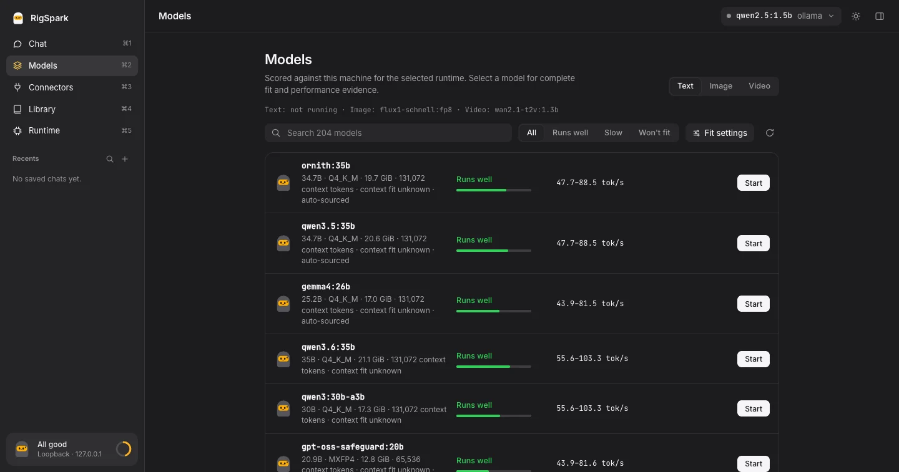

<h1 align="center">RigSpark Community</h1>

<p align="center">
  <strong>Run AI on your own computer: chat, make images and video, and talk to it.</strong><br>
  RigSpark checks your hardware and tells you which models will run <em>before</em> you download them.<br>
  Free and open source (MIT). No account. Your chats and files stay on your computer.
</p>

<p align="center">
  <a href="https://github.com/rigspark/rigspark/releases/latest/download/RigSpark_aarch64.dmg"><strong>Download for Mac (Apple Silicon)</strong></a> ·
  <a href="https://github.com/rigspark/rigspark/releases/latest/download/RigSpark_x86_64.dmg">Mac (Intel)</a> ·
  <a href="https://github.com/rigspark/rigspark/releases/latest/download/RigSpark_x64-setup.exe"><strong>Download for Windows</strong></a> ·
  <a href="#linux-and-the-command-line">Linux (opens in your browser)</a>
</p>

<p align="center"><sub>If RigSpark is useful to you, a ⭐ on GitHub helps other people find it.</sub></p>

## What you can do

- **Chat** with open models such as Llama, Qwen, Gemma and DeepSeek, fully offline.
- **Make images and short videos** from a prompt, in the same chat window.
- **Talk to it**: have replies read aloud, or dictate instead of typing.
- **Know before you download.** Every model gets a **yes / slow / no** verdict for
  your RAM and GPU, with the reason, so you don't wait for a 20 GB download that
  won't run.
- **Add any model from Hugging Face.** Paste a repository and RigSpark sizes each
  version against your machine, then picks the largest one that fits.
- **Hand off to your tools.** Copy a picture into any app, or send it to Canva,
  Figma and other connectors you add.

No GPU required: small models run on the CPU. On a Mac, RigSpark uses the
Apple Silicon GPU; on Linux, an NVIDIA GPU through Ollama or llama.cpp. Each
model shows its download size and memory need before you start.

<p align="center">
  
</p>

## Get started

1. **Download and open the app.** The Mac app is signed and notarized by Apple.
   The Windows installer needs no admin rights; it isn't code-signed yet, so if
   SmartScreen warns, choose **More info → Run anyway**.
2. **Click Download & start.** RigSpark picks a starter model that fits your
   computer, verifies the file, and starts it. Nothing else to install for chat.
3. **Chat, or press + to switch to Image, Video or Voice.** The first time you
   make a picture, RigSpark offers to set up its image engine for you.

Advice and chat work offline; RigSpark goes online only to download models and
updates you ask for. On a Mac the app lives in the menu bar, and updates
install when you approve them, after their signature is checked.

### Where each feature runs

| | Mac (Apple Silicon) | Mac (Intel) | Windows | Linux |
| --- | :---: | :---: | :---: | :---: |
| Desktop app | ✓ | ✓ | ✓ | browser app (`rigspark gui`) |
| Chat | ✓ | ✓ | ✓ (CPU) | ✓ |
| Fit check, Hugging Face models | ✓ | ✓ | ✓ | ✓ |
| Images and video, set up for you | ✓ | ✓ | your own ComfyUI | ✓ |
| Spoken replies | ✓ | other server | other server | other server |
| Dictation | whisper.cpp | whisper.cpp | other server | whisper.cpp |

"Other server" means any local speech server with OpenAI's audio API (such as
Kokoro-FastAPI or LocalAI), added under **Runtime → Voice settings**. macOS 12 or
newer. How much a model needs depends on the model: the fit check shows it for
each one rather than a single minimum.

## Linux and the command line

There's no Linux desktop app yet. On Linux, install the command line and run
`rigspark gui`: it opens the same app in your browser. With Homebrew on macOS
or Linux:

```bash
brew install shashankswe2020-ux/tap/rigspark
rigspark recommend             # rank models for this machine
rigspark can-run llama3.1:8b   # check one model before downloading
rigspark up llama3.1:8b        # download, verify and start it
rigspark chat                  # chat in the terminal
rigspark gui                   # open the app in your browser
```

Prebuilt archives for Linux, macOS and Windows are on the
[releases page](https://github.com/rigspark/rigspark/releases/latest).
[Cargo, checksums and upgrades →](docs/references/guide.md#install) ·
[Docker →](docs/references/guide.md#docker) ·
`llmup` remains a compatibility alias.

RigSpark runs models through Ollama, llama.cpp, MLX, LM Studio or BitNet, and
can point Claude Code, Codex or OpenCode at your local model with
`rigspark connect`. The [guide](docs/references/guide.md) covers every command.

[](assets/rigspark.mp4)

## Why you can trust the answers

- **Honest numbers.** When RigSpark can't source a figure, it shows `unknown`
  instead of guessing. Speeds are estimates, not benchmarks.
- **Verified downloads.** Model files must match a pinned SHA-256 digest before
  they run.
- **Local only.** RigSpark's servers listen on `127.0.0.1`, not your network,
  and it sends no usage data.
- **Catalog updates when you choose.** The model list is signed and only
  changes when you update it.

Updates only add or change models; recommendations and normal startup remain
offline.

```bash
rigspark catalog --status    # which catalog you have
rigspark catalog --update    # fetch and verify the latest signed catalog
```

`rigspark catalog --refresh` is a maintainer preview and doesn't install
anything. [How catalog updates work →](docs/references/guide.md#independent-catalog-updates)

## Community

RigSpark Community is free, MIT-licensed and built in the open. Bug reports,
model requests and pull requests are welcome:

- [Report a bug](https://github.com/rigspark/rigspark/issues/new?template=bug_report.yml) ·
  [Suggest a feature](https://github.com/rigspark/rigspark/issues/new?template=feature_request.yml) ·
  [Request a model](https://github.com/rigspark/rigspark/issues/new/choose)
- [Contributing guide](CONTRIBUTING.md) and
  [good first issues](https://github.com/rigspark/rigspark/labels/good%20first%20issue)
- [Changelog](CHANGELOG.md) · [Terms of Use](TERMS.md) · [MIT License](LICENSE)

If RigSpark saved you a download that would never have run, you can
[buy me a coffee ☕](https://buymeacoffee.com/shashanksw9).


## Code signing policy

Windows releases are being set up for free code signing provided by [SignPath.io](https://about.signpath.io/), with a certificate by [SignPath Foundation](https://signpath.org/) (application under review).

Committers and reviewers: [Shashank Mishra](https://github.com/shashankswe2020-ux). Approvers: [Shashank Mishra](https://github.com/shashankswe2020-ux).

Privacy: RigSpark does not transfer any information to other networked systems unless you ask it to, such as downloading a model, an update or the model catalog. See the [Terms of Use](TERMS.md).
